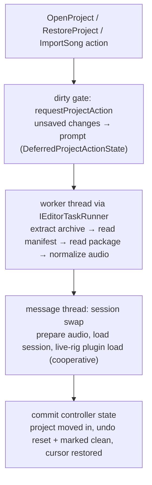

\page guide_project_lifecycle The Project Lifecycle

*Applies to: Editor-only (package IO delegates to common/core).*

"Project" is the editor's unit of work: opening, importing, saving, exporting, and closing songs.
Nearly every editor action is gated by this lifecycle, so its shapes — the workspace model, the
dirty gate, the worker-thread IO pattern — are worth knowing before touching anything
project-adjacent. The code lives in `rock-hero-editor/core/src/project/`.

# A project vs. a song package

A `.rock` **song package** is a flat ZIP: `song.json` plus the files it references. A `.rhp`
**project** is a ZIP wrapping that exact same native content under a `song/` subdirectory, plus a
tiny `project.json` manifest (its own format, its own `formatVersion` — never confuse it with the
song format; `project_io.cpp` owns it).

While a project is open, its contents live **extracted in a temp workspace directory** that the
`Project` object (`project.cpp`) uniquely owns — loaded audio paths point into the workspace,
edits happen on the extracted copy, and the `.rhp` on disk is touched only at save. Loading also
repairs backing-audio loudness-normalization metadata when stale (which counts as an unsaved
change — see dirty tracking below). Audio the analyzer cannot measure — digital silence, or a
level under libebur128's -70 LUFS gate — is normalize-and-report like everything else here, not a
refusal: `analyzeAudioForGainNormalization` answers with no record at all, the asset plays at its
raw level, and `unnormalizedAudioNoticeText` tells the charter once at open through the same
`IEditorView::showNotice` channel the chart-repair notice uses. That channel presents as a warning
box, not an info box — both of its notices report something the load settled without asking, which
the charter has to weigh before saving over the original.

Save and export share one serializer: both write the song through the identical
`writeRockSongPackageDirectory`, and the only difference is the archive root — save zips the
whole workspace (manifest + `song/`) into `.rhp`; export zips only the song directory into
`.rock`. That is "save is export" made literal: a `.rhp` is an exported song package wrapped with
a manifest. One caveat worth knowing: the archive write is in-place (truncate + rewrite), not
atomic temp-then-rename.

The song's information — title, artist, album and year — is edited in File > Song Information...
(one undoable edit through the marker funnel, \ref guide_undo) and travels in `song.json`'s
metadata, as it always has, so save and export both carry it.

# The open flow

Two mechanisms carry the correctness load:

- **The deferred-action state machine** (`deferred_project_action_state.h`) parks the requested
  action inside each prompt phase (`AwaitingUnsavedChangesDecision`, `AwaitingSaveAsPath`,
  `SavingBeforeReplay`) — a prompt with no parked action, or two prompts at once, is
  unrepresentable. After a successful save, the parked action replays exactly once.
- **Busy tokens + ownership transfer.** The open runs under a busy token; a close/exit during the
  load supersedes it and the stale completion self-discards. For writes, the `Project` object is
  *moved out of the controller* into the task state for the worker's duration, so package IO can
  never race controller-side mutation — and moved back on completion, success or not.

# Import

`ISongImporter` is a one-method port: `importSong(source, workspace) -> expected<Song, ...>`.
Two implementations, dispatched by extension:

- `RockSongImporter` — extract a `.rock` into the workspace and read it.
- `GpSongImporter` — Guitar Pro 7/8: parse `Content/score.gpif` (`gp_score_parser`, which rejects
  repeats/jumps — the chart format is linear time), require embedded backing audio, transcode it
  to FLAC (the canonical package audio format), build the tempo map from the score's audio sync
  points, and materialize one arrangement per track (`gp_chart_builder`). A staff's
  `TuningFlat` property is the score's own statement that its tuning is spelled with flats, and
  the import honours it verbatim — a half-step-down score's strings read `Eb2` and not `D#2`,
  and nothing is inferred for a score that says nothing. Guitar Pro 7.0.0 wrote that flag on
  every staff, so `gp_score_parser` reads the score's `GPVersion` and ignores the flag at major
  version 7. The backing track's
  signed `FramePadding` (44.1kHz frames) becomes the asset's signed `start_offset`: positive
  delays the audio, negative means the recording's head precedes the score and playback skips
  it. Most real charts carry a negative value, so dropping it desyncs the song. The builder then
  plays each bar's stated `TripletFeel` — the swing Guitar Pro leaves off the page (GP import
  rule 11) — resolves the score's gestures and clamps each ring at its own string's next onset.
  Neither fret-hand positions nor chord spans are stored: both are derived from the finished notes
  wherever they are read (the hand-position rules and the shape rules), so an import authors no
  position.

An import produces an **unsaved** project: no path, `save_requires_destination` set, so the first
save is forced to Save As — which is also the moment per-project view state starts persisting.

## The Guitar Pro import

**GP import rules** — what the builder does to a score beyond literal conversion. Its rules are
stated once, in \ref design_rulesets_gp_import, and code cites them from there ("GP import
rule 4", "the GP import figure law"); `test_gp_song_importer.cpp` covers them. In one breath: the
import plays what Guitar Pro leaves to playback — swing, tremolo strokes, trills and rolls — places
each grace in the time it steals, resolves every slide flag into an ordinary keyframed note, frames
frets and harmonic nodes absolutely against the capo, and reduces what the chart cannot hold rather
than refusing the song. Each note stores the ring its string actually sounds: a let-ring mark rings
to its figure's end, and every ring stops at the next onset on its own string.

A track builds in passes (`buildChart`), and their order is what a change to the import has to
keep:

1. **Events** (`collectEvents`). Each bar's feel is played and its tremolo beats are split before
   any duration is read; grace runs are placed and staccato rings halved as each beat's events are
   emitted; rolled beats spread over the events their beat just pushed; and trills spell out last,
   into the ring each note is finally left with.
2. **Notes.** Ties merge, and each note maps onto the chart: the capo frame, dynamics, harmonics
   and the reductions. A strike with nowhere to land becomes a pick here (`flattenStrandedStrike`),
   because the fret-hand derivation below reads the attack.
3. **Gestures.** Pick-slide carriers convert, the slide chains resolve against the next onset on
   each string, and legato landings leave the stream.
4. **Slide-ins** (`resolveSlideIns`) take their approach fret from a fret-hand derivation over this
   natural stream, run before the rings settle.
5. **Let ring** (`letRingFigureEnds`), the last pass that lengthens a ring.
6. **The clamp** (`clampSameStringOverlaps`): every ring ends at its string's next onset, and
   payload is trimmed to the ring.
7. **Slide-out exits** (`resolveSlideOutExits`), read from the settled rings and the natural-stream
   hand.
8. **The commit.** Every instant rounds onto the tick lattice (`roundOntoTickLattice`), the builder
   sheds the silent keyframes it wrote, and the chart goes through the load normalizer
   (`normalizeChart`, \ref design_rulesets_techniques), whose repairs the log counts by rule.
   `buildGpSong` then validates every chart, so nothing invalid leaves the import.

A pass that reads connections after one that moved a ring resolves them again (`chartConnections`)
rather than sharing an earlier walk. Every guess and every loss is a line in the import log —
"imported N pick slides", the repairs by rule, "assigned parts by track order and name (verify)" —
so the guesses stay observable.

**Tail policy — what a surface DRAWS** (GP notates every note at its full duration, and the chart
now *stores* that duration; a chart only *shows* deliberate sustains, so the shortening is a
read-side derivation rather than an import-time edit). The four tail rules are stated once, in
\ref design_rulesets_tails, implemented once in `chartPresentation` (`chart_presentation.h` in
common/core, covered by `test_chart_presentation.cpp`), and applied in the order written: crop each
tail's ink a minimum-sustain-distance margin before the next onset it does not ring past, drop the
tails of a strum that is short and effect-free, draw no tail on a dead note that makes no noise,
and rest every tail that shows no technique. They move nothing: every surface draws the stored note,
and presentation publishes only where each ring's INK stops. They are not import policy at all any
more, so the same chart drawn from a `.rock` file and from a fresh import shows the same tails, and
the model behind the split is `docs/plans/in-progress/note-sustain-model.md`.

Two of their consequences matter to the import. A run of 32nds imports every onset as notated and
renders as plain heads, its tails cropped toward zero and then dropped: the margin bounds tails,
never onsets. And what the arpeggio class reads is the STORED ring, never the ink (shape rule 5),
so a dead string draws no tail and still reads as carried under a strum: the finger is down either
way.

**Fret-hand position derivation** — not an import rule at all. GP has no hand-position concept and
the import authors none, so every position is derived at read, once per chart revision by
`fretHandResolutions` over the notes layer `chartResolutions` derives, so AFTER the spans and the
holds (notes, then grips, then positions: the spans never read the hand), by
`common::core::deriveFretHandEvents` (`chart/chart_fret_hand.h`). Its rules are stated once, in
\ref design_rulesets_hand_positions, and code cites them from there ("hand-position rule 8"). In
one breath: the song is cut into figures at chords, bar lines and a grip outgrowing the hand; the
hand sits at each figure's floor spanning its grip, never narrower than four frets unless a slide
proves it; and it never moves while a stop it holds still rings, nor for a one-fret figure the
standing window covers — unless a slide leaving it proves where the hand was.

The chart's `positions[]` hold only what a charter authored, and the derivation consumes each as a
statement: it stands until the chart contradicts it. A project whose stored positions predate the
derivation keeps them all as authored; the editor's Prune Hand Positions command removes each one
whose removal leaves the derived events unchanged.

Three facts about the hand live in the import and the views rather than in the ruleset:

- Only Guitar Pro's *Tapped* (two-hand) articulation becomes a chart tap (GP import rule 17), which
  demands nothing of the fretting hand; every tap in the GP import rules means a two-hand tap. A
  *LeftHandTapped* note is the fretting hand striking the note from nowhere and imports as the
  `LeftTap` attack verbatim, so it anchors the window like any fretted note, and a note carrying
  both marks imports as the left-hand tap. The 3D-highway camera frames a two-hand tap on its own —
  it scans the notes, not only the hand windows — so the tap stays on screen while the window stays
  low on the left hand.
- A slide-out places no window of its own; the hand rides it as derived MOTION
  (`deriveFretHandRides`, `FretHandResolutions::rides`). The rides are published in the hand's track
  beside the positions (`ChartViewState::fret_hand_track`) and read by the board's hand track alone:
  no chip, no click, no floor number, and the positions the scorer and the census read are
  untouched. Whatever arrives where a ridden slide-out ends — the ride itself, its return, or a
  window fronting there — travels the slide-out's own segment on its unpitched curve toward the
  window the slide rule places at the slide-out's end — the placement a slide arriving at a stop
  gets — so the hand follows the drawn rail, and settles off that curve into its own window where
  the rail stops being drawn.
- The import reads the positions derived from the notes as stored, after every ring has settled, for
  a bare slide-out's EXIT FRET (`resolveSlideOutExits`), as it does for a scoop's start fret (GP
  import rule 4). When the next window departs in the slide-out's direction AND arrives by the very
  next onset, the gesture IS the departure: the exit fret rides that travel (widened to GP import
  rule 4's two-fret minimum). Otherwise the slide-out keeps the fixed four-fret gesture, as does one
  running past the next onset or past the end of the score.

**Posture and shape derivation** — not an import rule at all. GP scores in practice carry no
handshape or diagram data, and the chart stores none either: a span is a statement about the notes
under it, so `common::core::deriveChartShapes` (`chart/chart_shapes.h`) derives every span and
posture from the note stream wherever they are read, once per chart revision inside
`chartResolutions`, and classes each span as a box or an arpeggio as it walks. Its rules
are stated once, in \ref design_rulesets_shapes, and code cites them from there ("shape rule 4").
In one breath: a span is the hand holding one grip, opened by a chord, by three rings sounding
together, or by a chord slide landing; it runs until a member stops sounding, a strike contradicts
the grip, or its statement turns between whole and in parts; and it is an arpeggio when its members
sound separately, whatever the other hand plays over it. Nothing about a hand is authored: the stop
the fretting hand holds under a right-hand onset is read off the notation — a pull-off's plant, or
the covering span's grip — and stored nowhere (`chartHeldStops`, shape rules 7 and 8). What reads
the spans: the brackets, boxes and posture digits both surfaces draw, the 3D board's hold pins
(`chartNoteLengths`), the held stops, and after all of them the fret-hand derivation above.

One consequence is worth naming: the derivation sees the SETTLED stream, where an import-time
derivation would run before `normalizeChart`. A strum whose notes carry something the rules refuse
— a slide on an open string, say — would otherwise derive its own span from data the chart never
contains; read at the settled stream it is what it is, and merges with its identically-played
neighbours. And because every member that stops sounding ends its span (shape rule 3), what keeps
let-ring passages from fragmenting is the GP import figure law's grip seam, not a member class that
classifies without bounding.

# Startup restore

`restoreLastOpenProject` re-opens the last project, with a crash tripwire: an
interrupted-restore sentinel is written *before* the load worker runs and cleared on success, so
a crash during restore is detected next launch and surfaces a Retry/Cancel prompt instead of a
crash loop. When there is nothing to restore, the editor stands up the Tone Designer — its
resting mode — rather than an empty shell.

`MainWindow` begins the restore before the window first shows. A window the startup state asks
for, such as the device-lost notice or the audio settings window, therefore meets the busy
overlay on the first presentable frame and waits for it to clear, rather than opening over the
plugin load, which holds the message thread and answers input only between plugins.

Per-project view state (cursor, grid note value, zoom, selected arrangement) persists in
**per-user editor settings keyed by project path, outside the `.rhp`** — deliberately, so moving
the cursor never dirties the project.

The view-state migration is complete (`docs/plans/completed/app-local-project-view-state.md`): the
manifest carries no editor state, and the store simplification shipped.

# Dirty tracking and faulting

`hasUnsavedChanges` is the union of three distinct sources — forget any one and the unsaved
prompt lies:

1. **Tracked edits**: `EditorUndoHistory::hasUnsavedEdits()` relative to the clean marker.
2. **Untracked changes**: dirtiness no undo marker can reach — load-time normalization rewrites
   (including the connection-claim settle every chart load runs, whose conversions arrive on
   `SongPackageRead::conversions`), a failed undo push, a faulted session.
3. **`save_requires_destination`**: an imported project with no path yet.

A **faulted session** (see \ref guide_undo) interacts with the lifecycle deliberately: Save is
blocked while faulted (the state is untrusted), the fault marks the session dirty, and only
reopening or closing the project clears it — recovery over silent corruption.

# Extending the lifecycle — silent steps

1. A new lifecycle-participating action must join the `ProjectAction` variant so the dirty gate
   defers it; a new write action joins `ProjectWriteAction` and gets a busy-operation mapping and
   an error prefix.
2. Anything the manifest gains must bump/gate `project.json` handling in `project_io.cpp` only —
   it is a separate format from `song.json` (see \ref guide_package_format).
3. New importers implement `ISongImporter`, put every produced file inside the given workspace
   (out-of-workspace references are rejected), and speak `SongImportError`.
4. Per-project *view* state goes to `EditorSettings` keyed by path — never into the package.
5. Tests live in `test_project.cpp` and the controller tests driving open/save/import through
   the harness with fake importers and task runners.
