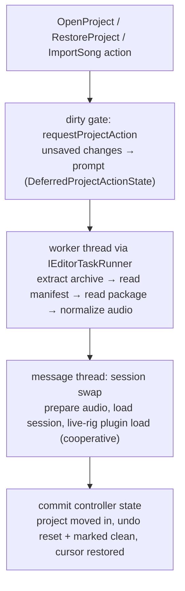

\page guide_project_lifecycle The Project Lifecycle

*Applies to: Editor-only (package IO delegates to common/core).*

"Project" is the editor's unit of work: opening, importing, saving, exporting, and closing songs.
Nearly every editor action is gated by this lifecycle, so its shapes — the workspace model, the
dirty gate, the worker-thread IO pattern — are worth knowing before touching anything
project-adjacent. The code lives in `rock-hero-editor/core/src/project/`.

# A project vs. a song package

A `.rock` **song package** is a flat ZIP: `song.json` plus the files it references. A `.rhp`
**project** is a ZIP wrapping that exact same native content under a `song/` subdirectory, plus a
tiny `project.json` manifest (its own format, its own `formatVersion` — never confuse it with the
song format; `project_io.cpp` owns it).

While a project is open, its contents live **extracted in a temp workspace directory** that the
`Project` object (`project.cpp`) uniquely owns — loaded audio paths point into the workspace,
edits happen on the extracted copy, and the `.rhp` on disk is touched only at save. Loading also
repairs backing-audio loudness-normalization metadata when stale (which counts as an unsaved
change — see dirty tracking below). Audio the analyzer cannot measure — digital silence, or a
level under libebur128's -70 LUFS gate — is normalize-and-report like everything else here, not a
refusal: `analyzeAudioForGainNormalization` answers with no record at all, the asset plays at its
raw level, and `unnormalizedAudioNoticeText` tells the charter once at open through the same
`IEditorView::showNotice` channel the chart-repair notice uses. That channel presents as a warning
box, not an info box — both of its notices report something the load settled without asking, which
the charter has to weigh before saving over the original.

Save and export share one serializer: both write the song through the identical
`writeRockSongPackageDirectory`, and the only difference is the archive root — save zips the
whole workspace (manifest + `song/`) into `.rhp`; export zips only the song directory into
`.rock`. That is "save is export" made literal: a `.rhp` is an exported song package wrapped with
a manifest. One caveat worth knowing: the archive write is in-place (truncate + rewrite), not
atomic temp-then-rename.

# The open flow

Two mechanisms carry the correctness load:

- **The deferred-action state machine** (`deferred_project_action_state.h`) parks the requested
  action inside each prompt phase (`AwaitingUnsavedChangesDecision`, `AwaitingSaveAsPath`,
  `SavingBeforeReplay`) — a prompt with no parked action, or two prompts at once, is
  unrepresentable. After a successful save, the parked action replays exactly once.
- **Busy tokens + ownership transfer.** The open runs under a busy token; a close/exit during the
  load supersedes it and the stale completion self-discards. For writes, the `Project` object is
  *moved out of the controller* into the task state for the worker's duration, so package IO can
  never race controller-side mutation — and moved back on completion, success or not.

# Import

`ISongImporter` is a one-method port: `importSong(source, workspace) -> expected<Song, ...>`.
Two implementations, dispatched by extension:

- `RockSongImporter` — extract a `.rock` into the workspace and read it.
- `GpSongImporter` — Guitar Pro 7/8: parse `Content/score.gpif` (`gp_score_parser`, which rejects
  repeats/jumps — the chart format is linear time), require embedded backing audio, transcode it
  to FLAC (the canonical package audio format), build the tempo map from the score's audio sync
  points, and materialize one arrangement per track (`gp_chart_builder`). A staff's
  `TuningFlat` property is the score's own statement that its tuning is spelled with flats, and
  the import honours it verbatim — a half-step-down score's strings read `Eb2` and not `D#2`,
  and nothing is inferred for a score that says nothing. Guitar Pro 7.0.0 wrote that flag on
  every staff, so `gp_score_parser` reads the score's `GPVersion` and ignores the flag at major
  version 7. The backing track's
  signed `FramePadding` (44.1kHz frames) becomes the asset's signed `start_offset`: positive
  delays the audio, negative means the recording's head precedes the score and playback skips
  it. Most real charts carry a negative value, so dropping it desyncs the song. The builder then
  plays each bar's stated `TripletFeel` — the swing Guitar Pro leaves off the page (rule 20c) —
  resolves the score's gestures and clamps each ring at its own string's next onset. Neither
  fret-hand positions nor chord spans are stored: both are derived from the finished notes wherever
  they are read (the hand-position rules and the shape rules), so an import authors no position.

An import produces an **unsaved** project: no path, `save_requires_destination` set, so the first
save is forced to Save As — which is also the moment per-project view state starts persisting.

## GP chart normalization policy

The plain-English specification of what the builder does to a Guitar Pro chart beyond literal
conversion. This section is deliberately written as numbered rules so a behavior tweak can be
made by editing a rule here and re-aligning the code
(`gp_chart_builder.cpp` — `resolveSlideIns` (rule 16's scoops), `resolveSlideOutExits` (the
slide-out exit fret, under the fret-hand position derivation below), and the one chart normalizer
`normalizeChart` (rule 26); all covered by `test_gp_song_importer.cpp`). The numbers start at 13:
rules 1 to 4 became the tail rules (\ref design_rulesets_tails), 5 to 9 the hand-position rules
(\ref design_rulesets_hand_positions) and 10 to 12c the shape rules (\ref design_rulesets_shapes).
Rules 13 to 25 apply to GP import only, and rule 26 is the normalizer every load path runs — `.rock`
imports and saved projects go through exactly the same function, so a chart written under older
rules is repaired and reported rather than refused.

**Ring policy — what the chart STORES.** `ChartNote::sustain` is the actual duration the string
rings: Guitar Pro's notated duration, lengthened where the source says one sounding continues (tie
merges, legato-slide merges), where the source says to LET IT RING (below), or where a synthesized
gesture needs room to travel (rules 13 and 16), and shortened by two rules of the importer's own.
A before-beat grace **steals its lead** from the beat before it in its own voice — Guitar Pro plays
the ornament in the preceding note's time — so every note of that beat still ringing at the run's
first onset ends there instead (rule 17); a bend, whose points Guitar Pro writes as percentages of
the notated duration, is laid out over that duration and CLIPPED with the stolen part rather than
squeezed into what is left.
The steal is a shortening like any other, and a pass that lengthens the same ring afterwards simply
out-rings it — which is how the reference's `max(tie/slide end, let-ring end)` is written here, as
an ORDER of passes rather than as a comparison, and why rule 17 needs no exemption for the marks
that lengthen. And a **re-strike stops the ring**: the same-string clamp (40-Q2-B,
`normalizeSustainOverlaps`) ends every tail at the next onset on its own string. The clamp runs
after every pass that can lengthen a ring — the let-ring figure walk below is the last of them —
and before the passes that read the settled rings — the chord spans (the shape rules), the
slide-out hand exits and the stored fret-hand stream, derived last of all; slide-in
resolution, and the derivation over the natural stream it asks, run ahead of it, because the
resolver's scoops are one of the passes that lengthen. Payload is trimmed to the ring
ONCE, straight after that clamp, because that is where the ring stops moving: the imported bend is
the only payload written past a ring, and trimming it earlier cut a let-ring note's curve against a
ring the let-ring pass was about to hand back.

**Let ring rings to its FIGURE's end.** Guitar Pro's `LetRing` mark is the mirror of staccato's
halving (rule 22): staccato shortens the imported ring, let ring lengthens it, and neither is ever
a stored field — the ring IS the record. A marked note's notated duration is inherently imprecise
— the mark is the transcriber saying "not this length", and no Guitar Pro charter can state the
real one — while Guitar Pro's own playback horizon is a default, not a statement. So the import
derives the end from the music's structure instead: **THE FIGURE LAW** (`letRingFigureEnds` in
`gp_chart_builder.cpp`). Three rules, held in one breath: *a marked tail rings to the first onset
its own voice states after its figure's last mark; a figure ends where its grip is contradicted or
where its audibility horizon runs out; written is the floor and the same-string clamp is physics.*

Each transcription VOICE accumulates a **grip** — the stop last stated on each string SINCE THE
FIGURE BEGAN, both halves of every comparison read through the one statement authority
(`statedStopAt`), so a slid finger carries its statement forward instead of manufacturing a
conflict and a tap states the stop its pull-off plants beneath it (nothing, for a bare tap): over
the gripped stop it rides the grip, over other ground it is a grip seam at the tap itself, as a
fretted note sounding there would be. A first-time string GROWS the grip and a
same-stop statement CONFIRMS it, so a chug can never split anything and a repetition of a figure
can never be divided — with no retreat mechanism in the law, that invariant is structural rather
than satisfied. An onset stating a different stop on a gripped string is the **grip seam**: it
closes the figure and founds the next AT ITSELF. The only other seam is TIME — an onset lying
strictly past the audibility horizon of the figure's most recent member, which ends the phrase
outright where a grip seam continues it (a phrase being a run of consecutive MARKED figures: a
figure carrying no mark ends it too). The figure's whole job for the tails is grouping the
MARKS — which let-ring stack a mark belongs to, and therefore where that stack's marked run ends.
One correction to that grouping, **the fragment donation**: a figure closed while holding too few
notes to ever FOUND a span — fewer than three, no two co-struck, the span machine's own founding
law rather than a new constant — is a remnant mis-grouped with the next figure's opening notes, so
each of its notes that does not contradict the closing figure's grip joins that figure and the
rest stay. A donation never crosses a time seam. A real figure never donates, which is what keeps
a repetition undividable and a closing confirmation with its own stack.

Every marked member's ring is then one assignment, `max(written, min(same-string clamp,
figure_end))`, where the figure end is **the first onset the figure's own voice states after its
last marked note** — the mark is the transcriber asking material to ring on, and the ring runs
exactly as far as the asking does; material past the marked run never asked, so a marked drone
must not ring into the unmarked chords that follow in its own line. Where the voice states nothing
more, the first sounding onset anywhere in the track answers; where nothing follows at all, the
figure's latest written end. And the end is FLOORED at the figure's latest marked WRITTEN end: a
written length is authored truth, not an estimate, so where one member's tie-merged written end
outruns the anchor the whole stack rings to it — the anchor and the cap bound only what the law is
estimating, and without the floor the lengthen-only application keeps the long written ring while
stopping its stackmates short. The GRIP SEAM never appears in the tail arithmetic — it is always
at or past the first onset after the figure's marks, so the anchor subsumes it. And the end is
never more than one ORIGIN-BAR metric length past that last marked onset — Guitar Pro's audibility
truth, which bounds a marked drone under a MARKED same-voice texture that nothing ever
contradicts, and which is the same horizon the time seam reads. An OPEN member takes the longer of
its figure's end and its whole PHRASE's anchor, capped by that phrase's own last mark: an open
string goes on sounding with no finger to lift, and a natural harmonic deliberately does not share
the lift, its node being false the moment the chime starts. The grip is FIGURE-SCOPED MEMORY, not
sound: a sounding grip needs a staleness guard, and that pair fails sighted figures in opposite
directions — figure membership is the one fact that separates them, so the grip lives and dies
with the figure and no staleness rule exists. The walk reads onsets and statements only — never a
ring, never a span — so it is a pure function of the written stream: no fixpoint, one forward pass
per voice. The marked REGION is not a segmenter: segmentation reads every onset, marked or not,
and the marks decide only who extends.

The walk is **scoped to one voice, end to end**, because events must not cut rings in another
voice: a figure is a statement about one hand's line contradicting itself, so the grip, the
statements judged against it, and the tails it bounds all take the same voice slot. The
**same-string clamp stays cross-voice** on purpose, and the difference is physics against
grammar: a restrike is one finger on one string and the sound stops whichever line wrote it, while
a grip contradiction is only the transcription saying a hand has moved. The derivation keeps its
own separate grip concept (the per-string evidence table of shape rule 3) and the two layers
deliberately DIFFER: the import's grip is figure-scoped grammar over a transcription with voices,
the derivation's is sounding evidence over a chart model with none — a change to either belongs to
its own law. The accepted cost is the registered drone watch item: a let-ring drone under a moving
melody in ITS OWN VOICE clips at the melody's first fret change, while a drone in a voice of its
own survives to the track's next onset.

Four notes never lengthen. Three are Guitar Pro's own pre-emptions, where playback returns before
it ever reads the mark: a **dead**, a **palm-muted** and a **staccato** note each keep the ring
their own mark gives them (only the pre-emption is taken from that block — the static durations it
returns are declined, because the notated duration is the timing information the chart reads). The
fourth is a note whose end is already stated by an unpitched slide-out — the slide-out keyframe —
since that statement IS the ring's end by definition. A note that ABSORBED a same-string merge — a tie continuation, a
legato-slide landing — is NOT among them: the merge states the note's true WRITTEN duration, and
the mark then extends the merged note like any other, Guitar Pro itself audibly ringing tied
let-ring notes past the written duration.

**SECTION MARKS APPEAR NOWHERE** in this law, and that is a ruling rather than an omission: a
section mark is organizational, not a hand fact, so it neither seams a figure nor bounds a tail.

The pass reports the rings it lengthened in the conversion log — counted AFTER the clamp, so a
ring physics took straight back is never announced as a change the reader cannot find — and
publishes the pair the census reads (`GpLetRingReport`): rings the figure end extended, and marks
left at exactly their written duration. The second is the mis-seam detector: under this law the
figure end is the only thing that ever lengthens a marked ring, so a mark that changed nothing is
either a texture the physics already bounds or a seam landing too early, and telling those apart
is the census's job. One ordering is RULED: the fret-hand positions are derived at read from the
settled rings (plan 60 §9 Q11), so the derivation's ring rule reads the stored ring, let-ring
extension included. The
planned hand coupling runs the other way (FHP → rings, clipping rings at position shifts), so the
extension inside the stored ring is owed a ruling before that coupling is built (plan 60 §9 Q3,
before Phase 6); until then nothing reads the FHP stream to shape a ring, and no cycle exists.

Nothing else shortens a ring. A dead note keeps its notated duration like any other — technique
rule 25 is a presentation rule and nothing applies it to the stored note — because that duration is
the timing the legato adjacency test reads, and the picture it does not draw is derived.
Readability otherwise is the next section, and it is drawn, not stored.

**Tail policy — what a surface DRAWS** (GP notates every note at its full duration, and the chart
now *stores* that duration; a chart only *shows* deliberate sustains, so the shortening is a
read-side derivation rather than an import-time edit). The four tail rules are stated once, in
\ref design_rulesets_tails, implemented once in `chartPresentation` (`chart_presentation.h` in
common/core, covered by `test_chart_presentation.cpp`), and applied in the order written: crop each
tail's ink a minimum-sustain-distance margin before the next onset it does not ring past, drop the
tails of a strum that is short and effect-free, draw no tail on a dead note that makes no noise,
and rest every tail that shows no technique. They move nothing: every surface draws the stored note,
and presentation publishes only where each ring's INK stops. They are not import policy at all any
more, so the same chart drawn from a `.rock` file and from a fresh import shows the same tails, and
the model behind the split is `docs/plans/in-progress/note-sustain-model.md`.

Two of their consequences matter to the import. A run of 32nds imports every onset as notated and
renders as plain heads, its tails cropped toward zero and then dropped: the margin bounds tails,
never onsets. And what the arpeggio class reads is the STORED ring, never the ink (shape rule 5),
so a dead string draws no tail and still reads as carried under a strum: the finger is down either
way.

**Fret-hand position derivation** — not an import rule at all. GP has no hand-position concept and
the import authors none, so every position is derived at read, once per chart revision by
`fretHandResolutions` over the notes layer `chartResolutions` derives, so AFTER the spans and the
holds (notes, then grips, then positions: the spans never read the hand), by
`common::core::deriveFretHandEvents` (`chart/chart_fret_hand.h`). Its rules are stated once, in
\ref design_rulesets_hand_positions, and code cites them from there ("hand-position rule 8"). In
one breath: the song is cut into figures at chords, bar lines and a grip outgrowing the hand; the
hand sits at each figure's floor spanning its grip, never narrower than four frets; and it never
moves while a stop it holds still rings, nor for a one-fret figure the standing window covers.

The chart's `positions[]` hold only what a charter authored, and the derivation consumes each as a
statement: it stands until the chart contradicts it. A project whose stored positions predate the
derivation keeps them all as authored; the editor's Prune Hand Positions command removes each one
whose removal leaves the derived events unchanged.

Three facts about the hand live in the import and the views rather than in the ruleset:

- Only Guitar Pro's *Tapped* (two-hand) articulation becomes a chart tap, which demands nothing of
  the fretting hand; every tap rule in this policy means a two-hand tap. A *LeftHandTapped* note is
  the fretting hand striking the note from nowhere and imports as the `LeftTap` attack verbatim, so
  it anchors the window like any fretted note, and a note carrying both marks imports as the
  left-hand tap. The 3D-highway camera frames a two-hand tap on its own — it scans the notes, not
  only the hand windows — so the tap stays on screen while the window stays low on the left hand.
- A slide-out places no window of its own; the hand rides it as derived MOTION
  (`deriveFretHandRides`, `FretHandResolutions::rides`). The
  rides are published beside the positions (`ChartViewState::fret_hand_rides`) and read by the
  board's hand track alone: no chip, no click, no floor number, and the positions the scorer and the
  census read are untouched. A ride, and a window fronting exactly where a slide-out ends, travel
  the slide-out's own segment with the unpitched ease, so the hand follows the drawn rail instead
  of sprinting to catch up after a margin morph.
- The import reads the positions derived before the rings settle for a bare slide-out's EXIT FRET
  (`resolveSlideOutExits`), as it does for a scoop's start fret (rule 16). When the next window
  departs in the slide-out's direction AND arrives by the very next onset, the gesture IS the
  departure: the exit fret rides that travel (widened to the slide-in rule's two-fret minimum).
  Otherwise the slide-out keeps the fixed four-fret gesture, as does one running past the next onset
  or past the end of the score.

**Posture and shape derivation** — not an import rule at all. GP scores in practice carry no
handshape or diagram data, and the chart stores none either: a span is a statement about the notes
under it, so `common::core::deriveChartShapes` (`chart/chart_shapes.h`) derives every span and
posture from the note stream wherever they are read, once per chart revision inside
`chartResolutions`, and `chartShapeArrivals` classes each span as a box or an arpeggio. Its rules
are stated once, in \ref design_rulesets_shapes, and code cites them from there ("shape rule 4").
In one breath: a span is the hand holding one grip, opened by a chord, by three rings sounding
together, or by a chord slide landing; it runs until a member stops sounding, a strike contradicts
the grip, or its statement turns between whole and in parts; and it is an arpeggio when its members
sound separately or the other hand plays over it. Nothing about a hand is authored: the stop the
fretting hand holds under a right-hand onset is read off the notation — a pull-off's plant, or the
covering span's grip — and stored nowhere (`chartHeldStops`, shape rules 7 and 8). What reads the
spans: the brackets, boxes and posture digits both surfaces draw, the 3D board's hold pins
(`chartHolds`), the held stops, and after all of them the fret-hand derivation above.

One consequence is worth naming: the derivation sees the SETTLED stream, where an import-time
derivation would run before `normalizeChart`. A strum whose notes carry something the rules refuse
— a slide on an open string, say — would otherwise derive its own span from data the chart never
contains; read at the settled stream it is what it is, and merges with its identically-played
neighbours. And because every member that stops sounding ends its span (shape rule 3), what keeps
let-ring passages from fragmenting is the import's own grip-contradiction cut above, not a member
class that classifies without bounding.

**Slide semantics** (resolved before the ring policy's clamp, so a merged or grown ring is
clamped and then drawn like any other):

13. **A shift slide re-picks its landing, and the chart PROVES it.** The origin states the
    landing's fret AT its ring's end, exactly ON that landing's onset, and nothing marks the
    statement as an arrival: an end statement naming the same stop the next head on its string is
    struck at, at the same instant, IS a glide into position and a pick (`arrivesIntoNextHead`,
    five clauses). Guitar Pro states no arrival time and none is synthesized — the arrival's instant
    is the head's own, which is what the hands did. The gesture degrades to an unpitched slide-out
    when the landing is an open string or no landing note exists at all. The string itself rings on
    until the landing re-picks it — the clamp is what ends it there — and its ink stops one margin
    before the landing (tail rule 1), so the arrival, stored at the landing's own instant, stands
    in the ring's ending zone and is drawn only under a reveal. The target note keeps its own onset
    and head. Where drawn, the arrival renders with its linked continuation glyph — the slide-out
    flag is false because the relation says so, never because of where the statement sits.
    Unpitched slide-outs are the SLIDE-OUT keyframe — the keyframe at the ring's end stating the
    gestured fret; no landing note exists, so there is nothing to desync from — and where a later
    head binds the ring, its ink stops at the crop like any tail while the slide-out keeps its
    stored instant. The gestured fret defaults to four frets out in the flag's direction and rides
    the hand's next anchor travel instead when it agrees (the departure case under the fret-hand
    position derivation).
14. **A legato slide is the same note continuing.** The landing is not re-picked, so it never
    becomes a note: it folds into the origin as a pitched keyframe at the junction — the
    sustain extends through the landing's notated end, the landing's sustain techniques
    (vibrato, tremolo, bends) fold in, and its own onward slide continues the chain until a
    shift slide, an unpitched slide-out, or the chain's end stops it. The tab renders the
    junction as Charter's linked continuation head, the same glyph `.rock` linked chains use.
    The importer never second-guesses the notated slide kind, chord landings included: a source
    charted with the wrong slide kind is fixed in Guitar Pro, not silently rewritten on import.
15. **A slide notated on a tied continuation belongs to the merged note — and leaves from the
    junction.** Tie merging folds the continuation's slide flags into the origin, so a held
    note that slides away at its end — a tie into a chord whose member then shift-slides down —
    keeps its glide instead of silently losing it with the merged onset. A hold keyframe at the
    continuation's own onset pins the pitch until then, so the glide starts where the sliding
    segment was notated (the tied 6 holds through the chord, *then* slides), not at the merged
    note's onset. The tab draws no slide line across a hold segment — the linked continuation
    head at the keyframe renders it as a note tied to itself, and the glide's diagonal leaves
    from there.
16. **A bare slide-in imports as an on-beat scoop — an ordinary slide in the note's own
    slot.** The ornament is the manner of the note's *attack*, not a moved head, and the notation's
    semantics are what say so:
    Guitar Pro's manual defines slide-in as attacking the note from an adjacent fret, its
    faithful open-source players pluck exactly on the notated tick and resolve to the target
    pitch a quarter of the duration in, and notation practice — MusicXML's scoop, the jazz
    plop — treats such approaches as zero-duration articulations of the note they attach
    to). The head keeps its notated position at a derived approach fret and an ordinary
    pitched keyframe rises to the notated fret over the scoop window: the minimum slide window
    measured forward from the onset (`minimumSlideWindow`), kept strictly before the note's slide
    chain and slide-out end (bend curves order only against the sustain, so the scoop leaves them
    untouched).
    The scoop is synthesis, so it may LENGTHEN a short note's ring to fit — the note sounds
    while it travels. Anticipation — approach before the beat, target landing on it — is what a
    before-beat grace with a slide notates, and that path already resolves through the ordinary
    chain; a bare slide-in never fabricates an early onset. The fret-hand positions supply the start
    fret: the delta arriving at the note in a derivation over the NATURAL stream (the hand-position rules, run
    before the rings settle, since the start fret must be chosen before they do), the flag's stated
    direction winning over a still hand or a contradicting delta (two frets out in the flag's
    direction), an agreeing one-fret delta widening to the same two-fret minimum.
    The scoop moves no window of its own: the stored scoop is struck at its approach fret and states
    the notated fret at its arrival, so the positions a reader derives cover both (hand-position
    rule 2). An open-string landing or a start that would leave the neck (into fret 1 from below)
    stays a plain note with a conversion note. The transformed note is a slide before
    anything reads it, so a slide-in into a held landing keeps its hold like any notated slide,
    cropped like every tail but never dropped as effect-free. A grace note
    sliding into its principal already carries its explicit start fret and resolves through the
    ordinary slide chain instead.

**Grace beats** (placed during event collection, before tie merging and every rule above):

17. **A grace beat takes no bar time and attaches to the next sounding beat in its voice.** A
    before-beat grace (GP's plain grace) sounds a thirty-second-note lead ahead of its
    principal — crossing the bar line backward when the principal sits on a downbeat — and
    **steals that lead from the beat before it**: Guitar Pro plays the ornament in the preceding
    note's time, so every note of that voice's previous sounding beat still ringing at the run's
    first onset ends exactly there; without the steal the stored ring overlaps an ornament the
    score never meant to sound under. A tie origin shortened this way still
    merges, because the merge keys on the tie flag rather than on adjacency. An
    on-beat grace (Ctrl+Shift+G) sounds on the principal's own position and delays the
    principal notes on the grace's strings by the same lead, with their notated ends unchanged.
    Runs of grace beats stack lead by lead, and grace notes keep
    their techniques — the classic hammer or slide into the principal resolves through the
    ordinary paths once the grace is a real note.
18. **Leads shrink rather than collide.** When the full leads do not fit — the voice's previous
    sounding onset closer than a before-beat run's leads, or an on-beat run no shorter than the
    principal's duration — the run shrinks to half the available gap, each of its leads taking an
    equal share of that half. A grace with no room at
    all (nothing sounds before a principal at the song start) or no principal to attach to (a
    rest follows, or the track ends) is dropped with a conversion note.
19. **Pick-slide flags convert their carrier into a pick-slide note.** GP notates a pick scrape
    as a dead note carrying Slide flag 64 (down) or 128 (up); the carrier is the encoding
    vehicle, so it sheds its mute and becomes an `attack: pickSlide` note with the
    corpus-derived default path (down 17 → 3, up the mirror) across the notated span, ready
    for the user to reshape. The path is the required unpitched terminal, the slide-out keyframe
    at exactly the sustain; turnaround keyframes are the user's to author, never synthesized. Simultaneous
    same-direction carriers are ONE scrape sounding on EVERY string the pick crosses, so each
    carrier becomes its own note on its own string, all of them sharing the gesture's longest
    notated span — the pick reaches the end of its travel once. Collapsing them onto the lowest
    string would understate a two-string scrape as a one-string one.
    A conflicting direction at the same onset is a notation error rather than a chord, so the
    first direction wins and the opposed carrier drops with a conversion note. The synthesized
    start fret is floored above the capo, because a note's `fret` is capo-validated whatever its
    attack. As ordinary notes, scrapes participate in every
    distance rule — the margin crop, deliberate holds (a scrape ringing
    strictly past a later onset is a hold; scraping through sounding strings is physically
    real), string occupancy. Presentation moves no point of the path: where a later head binds the
    scrape, the ink stops at the crop (tail rule 1) and the terminal keeps its stored instant in the
    ring's ending zone, drawn only under a reveal. `minimumSlideWindow`
    (`g_minimum_slide_window_seconds`) is for **synthesis**: a gesture built from nothing needs a
    default span.
    Dead notes
    carrying ordinary slide-out flags (4/8) are LEFT-hand figures and never reclassify. The
    fret-hand machinery ignores scrapes exactly as it ignores taps (`rightHandOnset`), keeping
    them FHP-transparent.
20. **Tremolo picking spells out as its strokes.** GP's tremolo mark is measured — the gpif
    `Tremolo` element carries the stroke length in quarter-note units ("1/2", "1/4", "1/8"
    for eighth/sixteenth/thirty-second strokes) — while the chart reserves `tremolo` for
    UNMEASURED noise, so a tremolo beat expands into its individual strokes before event
    collection and they flow through positions, graces, ties, and the tail rules like
    hand-notated notes. Strokes re-pick: a tie INTO the beat releases its origin, only the
    last stroke keeps a notated onward tie (a ring-out continuation still binds), and only the
    first keeps the emphasis — accent or ghost — or a legato arrival. A bent tremolo spells out
    too: each
    stroke samples the master curve at its own onset and carries the value as a flat prebend —
    the run reads as progressively larger prebent picks, and a sustainless note's bend
    narrows to that single prebend point generally (a zero-sustain pick has exactly one
    pitch). Only slide payloads keep the mark, with a conversion note: per-stroke frets along
    a glide would be fabricated data, and the payloads include the pick-slide carriers.

20a. **A trill spells out as its legato alternation.** GP's trill stores only the auxiliary note
    (`<Trill>` as a direct `Note` child, an absolute pitch; the format carries no speed), so the
    run expands at sixteenth steps — the one knowing estimate the format forces — principal,
    auxiliary, principal, with the first note keeping the onset's marks and remembering the
    run's take as stolen lead, every continuation claiming legato and carrying only the
    hand-truth mutes, and the last absorbing the remainder and the onward tie. Hammer and pull
    derive from the frets, never stored. A ring within one step, or an auxiliary the hand
    cannot reach — below the capo'd open, off the board, or the note's own stop — leaves the
    note single, with a conversion note; the capo'd open itself is a legal auxiliary (the run
    pulls off to it and hammers back).

20b. **A roll spreads its chord over a held grip.** GP's roll mark (beat-level `Arpeggio`;
    "Down" = a downstroke, lowest pitch first) carries its own spread in a beat XProperty —
    id `687931393` at 480 ticks per quarter, NOT the strum's sibling id `687935489` that
    alphaTab reads for both (its reading would import every real roll with zero spread) — so
    the beat emits as plain staggered notes: its members struck one at a time over the spread
    (ticks are half the chart's lattice, so every offset lands on the grid by construction),
    all rings ending together at the beat's stated end.

    **THE ROLL IS AN ACCUMULATION FIGURE PLAYED FAST, and it DERIVES**:
    the members' rings overlap, so shape rule 1's opening law opens the span and its dating rule
    dates it from the roll's FIRST member — same class, same bracket, and no import machinery at
    all: the note spread and the anticipation offsets below are the whole of what the importer
    does. The bracket therefore runs the RING rather than the stagger, which is the honest length.
    The statement model is what sounds, and "fronted span" is not a derivation concept.

    A spread the
    beat cannot hold, or a lone-note beat, stays simultaneous with a conversion note; a
    tremolo-split beat drops the roll, counted (the mark spreads the grip ONCE, so a stroke
    carrying it would state a hand re-taking stops it never left). The roll's second slider —
    "Start time", id `687931394` — is
    **honoured**: the figure opens `(1 - start_time)` of its written span before the beat, so at
    0 the last member lands exactly on the beat, and at 1 (or with the property absent, which is
    the field's default) the first member is struck on it as before. The whole figure moves while
    the ends stay where the beat states them, so an early member simply rings longer and an
    earlier ring on its string yields through the ordinary same-string clamp. No reference
    implementation exists — every open-source reader ignores this property — so the linear
    reading of the tool's own two labelled endpoints is the recorded semantic; a partial value
    rounds onto the chart's lattice, which is twice as fine as the tick. An anticipation with
    nowhere to open — before the song's start, or onto a slot an earlier sounding already holds
    on the same string, which is a collision the clamp has no bound for — starts on the beat
    instead, with a conversion note.

20c. **A bar's feel plays its written pairs.** Guitar Pro leaves a swung bar's rhythm STRAIGHT on
    the page and swings it on playback, so a chart that stores what sounds has to do the swinging
    at import; straightening every swung bar in silence loses what the score sounds like.
    The master bar's `TripletFeel` names a UNIT: the eighth (1/8 of a whole note) for the `8th`
    values, the sixteenth for the `16th` ones. Exactly the PAIRS move — two consecutive
    time-taking beats of one voice, each lasting exactly one unit, the first opening a whole
    number of pairs (two units) after the bar's downbeat — and the move is purely one of
    durations: the first beat plays the pair's first share and the second beat plays the
    remainder, so the second onset lands at the first's new end and the beat after the pair sits
    exactly where the page has it. The shares are two thirds and one third for a `Triplet` feel,
    three quarters and one quarter for a `Dotted` one, and one quarter and three quarters for a
    `Scottish` one — the last is the mirror of the second, the SHORT value first. A REST is a beat
    like any other, so a rest-then-note pair lands the note late exactly as a note-then-note pair
    does. Everything else keeps its written time: a unit whose partner is not one, a unit on an
    off slot, and any dotted or tupleted value, whose duration is simply not the unit. Grace beats
    take no bar time and are transparent — one between a pair's two beats neither breaks the pair
    nor moves with it — and the lead it steals comes off the SWUNG ring afterwards, through rule
    17 like every other lead. The feel is a per-bar statement, so a straight bar after a swung one
    is straight. The swing runs BEFORE the tremolo split (rule 20), so a tremolo-picked unit
    swings as a slot and its strokes fill the played length. The reference reading is alphaTab's
    `MidiFileGenerator._calculateTripletFeelInfo`, which matches Guitar Pro's own playback on the
    corpus.

**The capo frame** (Guitar Pro's frets are capo-*relative*; the chart's are absolute):

21. **A fretted note imports as source fret + capo; an open string stays 0.** Confirmed by an
    authored experiment — with a capo at 3, an entered "1" sounds the pitch at absolute fret 4.
    The chart stores absolute frets with `0` meaning the open string, capo'd or not, so the capo
    never appears as a fret number, and frets `1..capo` are invalid. Every *pressed* position the
    importer generates therefore floors at **capo + 1**: a slide-in's approach fret, a slide-out's
    exit fret, and a scrape's synthesized start — as does every derived fret-hand window. The
    capo itself is clamped to `0..12` (`g_max_capo`) with a conversion note when it was out of
    range.

22. **The score's two dynamics marks resolve onto one emphasis axis.** GP notates loudness as an
    `Accent` bitset (1 = staccato, 4 = heavy accent, 8 = accent) and quietness as a separate
    sibling element, `AntiAccent`, whose presence alone is the claim. Both loud bits import as
    `Accent` — a heavier chart tier is deferred, not lost — while **staccato is not dynamics at
    all: it is duration, so a note carrying bit 1 imports with half the ring it states** (Guitar
    Pro sounds it for exactly half, and no staccato field is stored — the short ring is the
    record). The ghost mark imports as `Ghost`. Because the source keeps the two independent, a
    note can in principle claim both; that is contradictory data rather than a state the chart
    models, and the **louder claim wins**, since a hit drawn quiet invites under-playing it where
    the reverse merely over-plays. No file in the corpus exercises the tie-break.

**Harmonics** (Guitar Pro's `HarmonicFret` means two different things, so the two families resolve
differently):

23. **A natural's label is its node; every other harmonic's is a partial label against its stop.**
    For `Natural`, the notated value (or, absent one, the source fret — which for a natural *is*
    the touched position in GP's capo-relative frame) resolves against an open string and lands on
    the real stop as `capo + offset`, with the note's own `fret` set to 0. For the fretted family —
    `Pinch`, `Semi`, `Artificial`, `Tap` — the label is a partial spelled as the familiar
    open-string position (18 of 56 corpus pinches name a position *below* their own fret, which no
    thumb can reach), so the node is `stop + offset`, the stop being the note's absolute fret or
    the capo when the string is open. `Pinch` and `Semi` take the `Pinch` attack (a semi-harmonic
    is a pinch whose fundamental keeps ringing — the honest nearest technique until the format
    distinguishes them, kept loud with its own conversion note), `Tap` takes the `Tap` attack, and
    `Artificial` keeps whatever attack the note had. **`Feedback` and unknown types are
    deliberately unsupported** — feedback needs a real amp in the room, which headphone play cannot
    produce — so the note survives as an ordinary one and the loss is counted.
24. **Labels snap to the node they name, inside a half-fret window.** Notation writes rounded
    labels, not measurements, and a touch even slightly off a node chokes the harmonic, so each
    label snaps to the true node nearest it, capped at the 8th partial
    (`g_max_snapped_partial` — taken from Guitar Pro's own output). Real labels land within 0.331
    of a node while the integer frets with no harmonic near them (1, 11, 13, …) miss by 0.669 or
    more, so a label farther than **half a fret** from every node names nothing: on a natural the
    harmonic is dropped and the note stays ordinary; on the fretted family the **octave** takes
    over (the lowest-order harmonic available at any stop, hence the easiest to ring), as it does
    when the source supplies no label at all. A node that would then sit past what the note can
    reach — `harmonicNodeCeiling`: the neck when the fretting finger stands on the node, the
    string otherwise (a tap harmonic's node is the picking hand's, so it runs to the string) —
    also falls back to the octave. Each case carries a counted conversion note.

**Reductions, and the closing repairs** (import is a commit point, so nothing invalid leaves here):

25. **An out-of-range value is reduced and reported, never carried to validation** — where it would
    refuse the *whole* song over one field. A note naming a string the tuning does not have is
    dropped (the lane does not exist); a fret past the last one, once shifted by the capo, is
    pulled back to `g_max_fret`; a track declaring more than eight courses loses the extra ones.
    Each reduction is counted and named in the import log.
26. **The finished chart goes through the one normalizer, `normalizeChart`.** It lives beside the
    rules it satisfies in `chart_rules` — a list kept in the importer drifted from the list there
    twice, and a dead note carrying a bend reached validation intact and failed a whole import — and
    it is the same function the package reader runs on every load, so import and load cannot
    drift. Per note (`normalizeChartNote`, in stage order): the board ceiling clamps a fret,
    keyframe, or exit; the capo floor lifts a scrape's start and every exit and drops a keyframe;
    the technique exclusions fire — **the deadening wins outright** (a dead note drops its bend and
    its whole vibrato width, at either tier, and keeps its node, which is positional; the dead
    pinch alone loses its harmonic, since its node lies off the neck), a tap harmonic drops its
    tremolo, a fret-hand harmonic drops its payload, an open string drops its slide; a strike with
    nowhere to land becomes a pick; and last, a scrape that no longer travels becomes the pick it
    sounds like. A dead note's tail is NOT trimmed here — technique rule 25 is a presentation rule
    (tail rule 3), and the stored ring is the timing a legato claim after the cluck reads. Then the
    one stream-level note rule bounds every ring at its own string's next onset (40-Q2-B,
    `normalizeSustainOverlaps`, reported as `OverlappingTail`), and hand windows fit onto the board.
    Technique rule 4's strike requirement is ALSO decided earlier, the moment a note's node is known
    (`flattenStrandedStrike`), because the hand-window pass reads the attack and must not shape a
    song around a tap that cannot survive. The relational half is the normalizer's last stage — the
    same sweep every settle point runs, `sweepUnjustifiedLegato` — so a chart is never born carrying
    a statement its own notes contradict. It runs last because it reads the finished stream:
    released frets after the slide chains (rules 13-15), holds after the ring policy's clamp. The
    spans a reader derives therefore describe the SETTLED stream (the shape rules). After it, every
    authored hand position that leaves a fretted note gripped at its instant uncovered is dropped
    (`uncoveringFretHandPositions`, reported as `UncoveringHandPosition`): a converter cannot apply
    that rule, and the notes derive a window there. An import authors no position, so only a load
    meets it. The importer counts the repairs by rule in its log; the editor's open shows them once
    with positions. Guitar Pro's hammer-on/pull-off destinations import as the `Legato` claim and
    nothing more — the score says the notes connect but not which way, which is exactly what the
    claim says — so the junk flags real scores carry (a mark with nothing before it, or with a
    predecessor at the same stop) are what this sweep converts, counted in the import log. It reads
    the predecessor's stored RING and asks strict adjacency: a string that stopped sounding before
    the onset is a released string, so a predecessor that no longer reaches justifies no connection
    at all.

Every generated track logs a conversion note ("derived; verify", "derived N chord
spans", "imported N pick slides") so the guesses stay observable in the import log.

# Startup restore

`restoreLastOpenProject` re-opens the last project, with a crash tripwire: an
interrupted-restore sentinel is written *before* the load worker runs and cleared on success, so
a crash during restore is detected next launch and surfaces a Retry/Cancel prompt instead of a
crash loop. When there is nothing to restore, the editor stands up the Tone Designer — its
resting mode — rather than an empty shell.

`MainWindow` begins the restore before the window first shows. A window the startup state asks
for, such as the device-lost notice or the audio settings window, therefore meets the busy
overlay on the first presentable frame and waits for it to clear, rather than opening over the
plugin load, which holds the message thread and answers input only between plugins.

Per-project view state (cursor, grid note value, zoom, selected arrangement) persists in
**per-user editor settings keyed by project path, outside the `.rhp`** — deliberately, so moving
the cursor never dirties the project.

The view-state migration is complete (`docs/plans/completed/app-local-project-view-state.md`): the
manifest carries no editor state, and the store simplification shipped.

# Dirty tracking and faulting

`hasUnsavedChanges` is the union of three distinct sources — forget any one and the unsaved
prompt lies:

1. **Tracked edits**: `EditorUndoHistory::hasUnsavedEdits()` relative to the clean marker.
2. **Untracked changes**: dirtiness no undo marker can reach — load-time normalization rewrites
   (including the connection-claim settle every chart load runs, whose conversions arrive on
   `SongPackageRead::conversions`), a failed undo push, a faulted session.
3. **`save_requires_destination`**: an imported project with no path yet.

A **faulted session** (see \ref guide_undo) interacts with the lifecycle deliberately: Save is
blocked while faulted (the state is untrusted), the fault marks the session dirty, and only
reopening or closing the project clears it — recovery over silent corruption.

# Extending the lifecycle — silent steps

1. A new lifecycle-participating action must join the `ProjectAction` variant so the dirty gate
   defers it; a new write action joins `ProjectWriteAction` and gets a busy-operation mapping and
   an error prefix.
2. Anything the manifest gains must bump/gate `project.json` handling in `project_io.cpp` only —
   it is a separate format from `song.json` (see \ref guide_package_format).
3. New importers implement `ISongImporter`, put every produced file inside the given workspace
   (out-of-workspace references are rejected), and speak `SongImportError`.
4. Per-project *view* state goes to `EditorSettings` keyed by path — never into the package.
5. Tests live in `test_project.cpp` and the controller tests driving open/save/import through
   the harness with fake importers and task runners.
