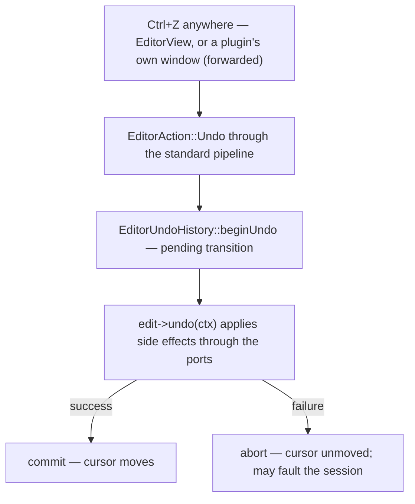

\page guide_undo The Undo System

*Applies to: Editor-only (the engine's capture machinery lives in common/audio).*

Undo is RockHero-owned, by decision: one unified history of `IEdit` mementos spanning every
domain — chart, tones, plugins, automation, gain — where one Ctrl+Z reverses exactly one user
gesture. Tracktion's built-in undo is never the product undo stack.

# The history (`editor_undo_history.h`)

`EditorUndoHistory` is a **pure timeline**: a vector of `IEdit` entries plus a cursor. It applies
no side effects itself, which is what makes it fully unit-testable. Its one non-obvious contract
is **two-phase application**:

1. `beginUndo()` / `beginRedo()` return a pending transition *without* moving the cursor.
2. The caller applies the edit's side effects through `EditorEditContext` (a bundle of the
   session and the ports: signal chain, plugin host, live rig, tone automation, the tone's output
   stage, tone designer).
3. Only on success does the caller `commit(pending)`; on failure it `abort(pending, code)` and
   the cursor never moved. Pending transitions carry a token, so a stale commit is rejected.

The history also owns the clean marker (`markClean` on save, `hasUnsavedEdits`, and the
unreachable-marker case when history is truncated) and exposes `snapshot()` for the history
overlay UI.

# The edit families

Every undoable domain contributes small memento structs, usually an `*_edits.h` family:
`signal_chain_edits.h` (insert/remove/move/placement/display-type/state/gain),
`chart_edits.h` (one plan-replaying chart edit per gesture —
insert/delete/move/retype/sustain/legato/attack, all seven authoring planners
funnelled through the same finalize step, plus the settle sweep's `planSettleChart`, which
deliberately bypasses that funnel because flattening a claim to a plain pick can violate no rule;
see the plan/apply split in \ref guide_patterns. One `ChartEditPlan` is one change to the note
stream, which is the only per-string authored array there is, carrying the shape holds and the
authored fret-hand positions whole where the finalize step's normal form rewrote them
(`StreamChange`: a hold cropped, extended or dropped, a position the result no longer covers
dropped), so one undo restores the notes, the holds and the positions together;
`chartWithPlanApplied` applies a plan to a chart it owns, so a failed precondition part way through
discards that value, and `applyChartChange` runs it on a copy it
swaps in only on success, leaving the chart entirely untouched otherwise),
`marker_model_edit.h` (ONE `MarkerModelEdit<Snapshot>` behind every timeline-marker verb of every
kind, carrying that kind's whole model before and after; every marker verb commits through one
funnel, `commitMarkerModel` in `marker_model_commit.h`, which normalizes the produced model,
validates it against one `MarkerJudgeContext` (`marker_judge_context.h`: the session and the
displayed chart's memoized notes layer, the same for every snapshot kind, so the funnel names no
kind), refuses it whole, records nothing when nothing changed, releases a selection naming a
marker that is gone, resyncs the audible tone and the engine's tempo-derived caches
(`syncTempoDerivedAudio`) and publishes once. The entry it pushes holds each side's WRITTEN form
(`writtenModel`, `writtenMarkerEdit`): every model is its own, except the song timeline, which
sheds a time signature restating its reign — authoring state the editor holds in memory only while
its chip is selected (below) — so a commit whose two written forms agree lands in memory and
records nothing (`MarkerCommit::Silent`). Verbs build their result on a
COPY and hand both sides over, so a refusal leaves the live model untouched by construction —
there is no restore path. Every marker MOVE verb (`Alt+←/→` on a section, tempo anchor, time
signature, hand position or tone change) commits through `commitMarkerMove` beside it instead, which adds the
held-run rule: a run of presses on one selected marker is ONE entry, however fast or slow, because
a press continuing the run widens the run's entry (`replaceTop`) from the model before its first
press, and a press whose entry would describe nothing — walked back to where it began, or onto
authoring state the history does not hold — drops the entry (`dropTop`) and ends the run, since a
run owns the history's top or nothing. No timer
decides it — the run ends at any other commit point: another edit, a selection change, undo or
redo, a save. It makes the landing selection itself, before the landing publishes, since a
selection change ends the run and only the funnel may survive its own, and the landing select is
a settle point the moved marker must be in focus for. A move that is not invertible step by step builds each press
from the run's origin (`markerMoveRunOrigin`), so a run walked back lands that origin exactly.
The tempo chip's pointer drag is NOT a run: it is one gesture whose events write nothing (they
hold the move and publish a preview map, plan 66 decision 7), and its release makes the one
commit a single `Alt+←/→` press would, so the drag is one entry, one engine resync and one
re-projection, and a drag released where it began records nothing.
Five snapshots plug in today: `TempoMapSnapshot`
(`timeline/tempo_map_snapshot.h` — the song's whole tempo map behind anchor insert, typed tempo,
move and delete; its `validate` is the shared `validateTempoMapRules`, and its apply goes through
`Session::setTempoMap()`, which advances the chart revision because the map places every note),
`ToneModelSnapshot`
(`tone_model_snapshot.h` — the whole tone model, catalog plus track, behind split, delete, retone,
rename and boundary-move; its `normalize` prunes catalog tones no region references and its
`validate` is `validateToneTrackRules` plus catalog coverage), `SongSectionsSnapshot`
(`song_sections_snapshot.h` — the whole song-level section list behind add, rename, move and
delete; its `normalize` sorts by position and its `validate` is the shared
`validateSongSectionRules`) and `FretHandPositionsSnapshot`
(`chart/fret_hand_positions_snapshot.h` — the current chart's whole list of AUTHORED fret-hand
positions behind the fret-hand position's add, move, fret entries, end clear, delete and the
Prune Hand Positions command — a stating verb on a DERIVED position authors it inside the same
entry, and a prune that finds nothing redundant records none; its `normalize` sorts by position,
its `validate` is the chart gate's own `validateFretHandPositions` plus `validateFretHandCoverage`
(each authored position covers every fretted note gripped at its instant), read against the notes
layer the controller already holds, and its apply writes through
`Session::writeFretHandPositions()`, which advances the chart revision the projections are keyed on
and leaves the notes revision, so the notes layer survives), and
`SongTimelineSnapshot` (`timeline/song_timeline_snapshot.h` — the song's WHOLE timeline, the
common-core `SongTimeline`: the map, the sections and every arrangement's chart, tone track and
automation, behind the time-signature verbs, the locked Scale Tempo and every tempo edit made with
the Note Lock on (a held nudge run and a chip drag included), since each re-addresses all of it in
every arrangement and lands as ONE entry per command — under the lock, the content the lock holds
re-addressed under the verb's map, so the entry's `before` and `after` both descend from the lock's
origin and undo and redo among them keep it (\ref guide_musical_time); its `normalize` brings every
chart's shape holds to their normal form under the new map (`normalizeShapeHolds`), returning the
conversions for the landing to report once (`reportChartConversions`) and every chart's notes layer,
derived once per edit for its `validate` and for the memo the landing seeds
(`MarkerModelNormalization`, `seedNormalizedNotesLayer`), its WRITTEN form drops a meter restating its reign — the same meter as the authored reign before
it, from one of that reign's own downbeats (`withoutRedundantTimeSignatures`, common core, which
the package writer and reader apply too; a repeat placed off that grid cuts a bar short and
stays) — its `validate` runs the tempo-map, section and chart rules, and its apply is
`Session::setSongTimeline()`, the one session write that reaches a non-current arrangement. Such a
restating meter is the keyframe commit law's meter row: it stays in the live map while its chip is
selected, so `Alt+←/→` can walk a repeat across its predecessor's downbeats and `Ctrl+/` typing the
prevailing meter on a downbeat shows a selected chip to retype, and it dissolves with no entry
when the selection leaves it (`dissolveRedundantMeters`, run by the settle and before every undo
and redo, exactly as `dissolveSilentKeyframes` is). Retyping the focused chip is one real entry
whose `before` is the written form, so no undo ever lands on the chip). Every
grid commit (`commitGridModel`) lands through `landMarkerModel`, the funnel without its publish,
carries the keyboard by the model's own rule (`carryKeyboardAcrossGrid` with the snapshot's
`GridCarry`, through `carryCursorTo`, which seeks only where the transport no longer stands at the
carried place), leaves the landed marker selected or nothing, because where every address moved
the old selection would name other music, and then publishes once. Undo and redo of a grid entry
make the same carry (`applyPendingEdit` asks `IEdit::gridCarry`), so neither leaves the keyboard
on an address that now names other music, and neither counts as a keyboard move.
Whole-model in every case because a tone delete or retone can MERGE regions and a section or
placement move re-sorts the list, so an inverse command would have to know every record the edit
took; a handful of small structs costs nothing to copy, and the round trip is exact by assignment.
The section snapshot lands through `Session::setSongSections()`, needs no arrangement, and touches
no fret-hand position: the derived ones are re-derived at read from the notes and the authored
list, which no section edit changes),
`tone_automation_edits.h` (one full point-list edit per gesture), and `tone_designer_edits.h`
(document replace, tone import). Capture rules that keep fidelity:

- Capture the before-state **before** mutating, and push exactly one entry per user gesture.
  Multi-digit fret typing is one gesture by construction: the typed value stays PENDING —
  nothing reaches the chart until the entry settles — so the whole number commits as one entry
  with no splice (the W3 pending model; `settleChartFretEntry`, `chart_handlers.cpp`).
  A toggle whose second press provably reverses its own first press (the technique toggle window)
  applies the entry's inverse and removes it via `EditorUndoHistory::dropTop`, so the pair
  leaves no trace. A run of GESTURE steps is one gesture the same way, but by REPLACEMENT: each
  press appends its step to the run's list, re-plans the whole selection by replaying that list over
  the state the run started at, and swaps the entry via
  `replaceTop`, so however many keys were pressed, one entry describes start → now and one Ctrl+Z
  undoes the run — and a run that replays back to its start ends at `dropTop` like the
  toggle, since an entry describing nothing is a dead Ctrl+Z on a document reported modified that
  is byte-identical to the file. THREE verbs run this shape today and share ONE authority
  (`commitChartGestureStep`, `chart_handlers.cpp`), which is what keeps them from drifting into three
  copies: the duration steps (`AdjustChartSustain`, ruled 2026-08-22 — before it, every step was its
  own entry), the `Alt`+arrow move (`moveChartSelection`, the same replayed gesture), and the
  fret-hand harmonic verb `H` (`ChooseChartHarmonic` / `SetChartHarmonicNode`, which joined
  2026-09-16 when it stopped being a toggle). The harmonic verb is the one with nothing to replay:
  its "gesture" is the LATEST CHOICE, planned from the pre-run chart, so `ChartHarmonicGesture` is an
  empty alternative — and because the fold RETIRES an entry that returns to the pre-run state, `H`
  `Return` `H` `Return` leaves no trace of a carrier the VERB itself produced, by that rule rather
  than by a second-press reversal. The rule is a PLAN test, not a keystroke count: over an imported
  carrier whose payload (a bend, vibrato) the set normalized away, the round trip does not return to
  the pre-run state, so its entry — describing that real strip — correctly stays.
  The other two keep
  their STEPS rather than one summed delta: a duration step moves the ring's END onto the adjacent
  line of the placement quantum's lattice, so what it adds is whatever reaches that line (a summed
  delta carried a remainder through every later step — fixed 2026-08-23); a move step carries the
  selection by its anchor's distance to the adjacent line from where the run has REACHED, in whole
  notes, so a run crossing a signature change steps by two different amounts. The move is also the
  one whose steps RE-KEY what they move — a note's key is its slot, a keyframe's identity is its
  offset — so it states where the run has landed and the window's proof compares against those
  re-pointed keys. All three splices refuse when the top entry is the reachable clean
  state — the file holds what that entry produced, so rewriting or erasing it would make "return to
  clean" restore content the file does not have. A verb that must still act there pushes instead:
  the technique toggle's reversal becomes its own inverse entry (the tail still comes back, the
  session stays correctly dirty), a gesture step opens a new run from the saved values, and the
  legato settle sweep pushes its flatten rather than folding it.
- The **inert-held-stop settle** needs none of that machinery, and the contrast is worth naming: it
  runs INSIDE the plan gate (`finalizePlan`), so the held stops an edit strands are part of that
  edit's own plan and one Ctrl+Z restores them with it. It can, because unlike a legato claim it
  never arrives on its own — a held stop states nothing only because some edit made it so, and the
  edit is right there to carry it.
- The **legato settle sweep** is the one edit that arrives with no user gesture of its own, so its
  commit shape is decided by where the cursor sits (`settle`, `chart_handlers.cpp`):
  on top of history it FOLDS into the burst's own chart-notes entry via `replaceTop`, so one Ctrl+Z
  restores the edit and the claim it broke together; with no such entry it PUSHES its own (at
  top-of-stack a push truncates nothing) — and the burst has no such entry both when no chart edit
  opened it and when the newest one WROTE NOTHING, because an edit whose written diff is empty
  pushes no entry and therefore clears the record rather than leaving it naming the edit before it
  (`applyChartEditPlan`, fixed 2026-09-21: left standing, that record still passed the position
  proof, and the next gesture press reversed a stranger's plan and retired a stranger's entry);
  at a mid-stack resting point — reachable only through
  undo — it **defers entirely**, because rewriting an entry the cursor is not on would either
  truncate a live redo branch or leave history describing a state the chart does not hold.
  Deferring is safe because nothing derived is stored: the claim simply displays as its resolution
  until the cursor returns to the top. Every written file is clean regardless — the document
  writer serializes the resolved form.
- Plugin edits store the **full opaque plugin state** (`PluginInstanceState`, raw
  `getStateInformation` bytes) — granular parameter replay was rejected by decision; full-state
  restore is the fidelity guarantee.
- State that must survive round trips rides along: `PluginRemoveEdit` carries the plugin's
  automation out with it and restores it verbatim on undo.
- Edits that recreate plugins report `instantiatesPlugin(direction)` so replay runs behind the
  busy fence.

# The Ctrl+Z path

Note the first hop: Cmd/Ctrl+Z pressed inside a hosted plugin's *own editor window* is
intercepted and forwarded to this same global history — plugins never see it (see
\ref guide_signal_chain).

# Undo is never blind — the transition's focus

A committed transition brings what it changed into focus: it becomes the selection and the
keyboard position moves onto it, and the view centres it when it lands off screen. The edit
answers, because it holds its change: `IEdit::focus(direction)` returns an `EditFocus`
(`controller/edit_focus.h`), and `completeUndoTransition` hands it to `focusUndoTransition`
before the selection repair (a recorded focus can name a silent point the undo dissolved).

- **Chart** (`ChartEdit::focus`): RECORDED, not derived. Each entry holds an `EditFocus` for each
  side — where the charter stood as the edit began and where the verb left them, captured by
  `chartEditFocus` in `applyChartEditPlan` and carried on the burst record so the gesture and
  settle folds keep them — and undo restores the first, redo the second. A diff says what changed,
  never where the charter stood: undoing a ring cut rewrites the note the caret stood on a
  keyframe of, and only the record says it was the keyframe. In the chart (`ChartEditFocus`), one
  object arms the caret on it (on the recorded stop); several are selected with the passive cursor
  at the first; none leaves the caret on the recorded slot, selecting nothing. A selected span
  or none hold is recorded as the marker it is (`MarkerEditFocus`), so undoing a hold verb
  re-selects the span or hold it acted on, as every marker entry does.
- **Markers** (`MarkerModelEdit::focus`, which asks the landing snapshot's
  `focusReplacing(replaced)`): the marker the transition added, moved or rewrote is selected with
  the cursor at its start; one it removed leaves nothing selected and the cursor where it stood.
  `firstChangedRecord` is the one diff every snapshot uses; the tone model falls back to the first
  region sounding a renamed tone when only the catalog changed. A whole-song verb (Scale Tempo)
  records `EntryFocus::None`: it changed every marker, so no one of them is what its undo changed,
  and the transition focuses nothing and leaves the window where it stands, as the verb did.
- **Tone automation** (`ToneAutomationPointsEdit::focus`): the lane caret lands on the changed
  point's slot and selects the point if it is still there.
- **Off the timeline** (plugin chain, Tone Designer): the default, nothing; the selection repair
  alone answers there. Plugin tiles have no selection yet.

Skipped while the transport plays: playback follow owns the view and no caret may arm. The view
half is the window rule *an edit that asks keeps its result in sight* in \ref guide_keyboard.

# Where plugin edits come from

Users mostly edit plugins inside plugin GUIs, which the editor cannot see directly. The engine
bridges that (`plugin_dirty_tracking.cpp`): every parameter change marks *dirty*, but only a
GUI parameter **gesture** marks *user intent*, and a settled state transaction becomes a
`PluginStateEdit` only when intent was present. Plugin self-re-announces (insert, restore,
internal preset load) fold into the baseline silently — that gate is what keeps phantom "Edit
plugin" entries out of the history. During undo/redo restores the engine defers capture entirely
(`ScopedPluginUndoCaptureDeferral`) so restoring state never records new edits.

# The rollback contract

An edit's apply either succeeds, or rolls back to a provably unchanged state, or — if it can
prove neither — the session **faults** (`faultSessionAfterRollbackContractViolation`): the
editor stops trusting in-memory state, marks unsaved work, and routes the user to reopen. Faulting
is deliberately loud; a silently half-applied undo would corrupt trust in the entire history. If
you write an edit whose failure path cannot restore the before-state, returning
`RollbackContractViolation` is the correct move — never pretend success.

# Adding undo for a new domain — silent steps

1. A new `*_edits.h` family in the feature's folder; each edit captures complete before/after
   values (prefer whole-value mementos over deltas).
2. If apply needs a port the `EditorEditContext` doesn't carry, extend the context — don't reach
   around it.
3. Push through `pushUndoEntry` at gesture end, once per gesture (preview changes push nothing —
   see the tone-output preview/commit split in \ref guide_signal_chain).
4. If the domain is on the timeline, override `IEdit::focus` so its transitions bring their
   change into focus. Nothing fails to compile without it — the default focuses nothing, and the
   transition is silently blind again.
5. Tests: round-trip every edit (do → undo → assert exact before-state → redo → assert
   after-state) in `test_editor_undo_history.cpp` style, plus the failure/abort path.
